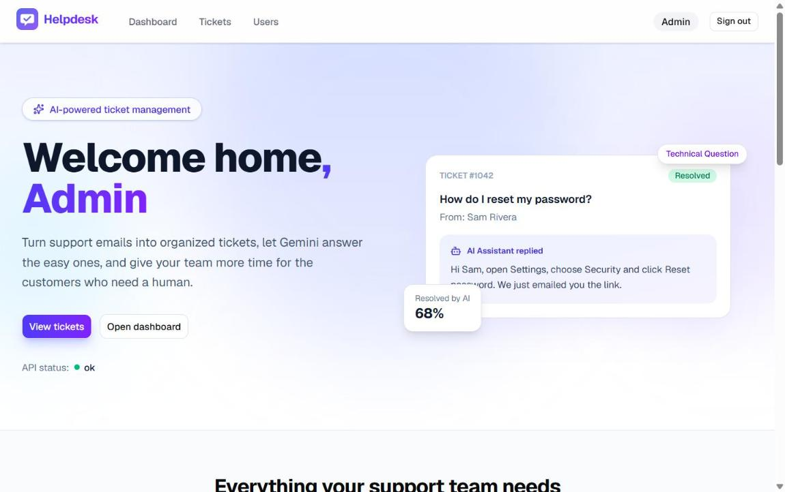
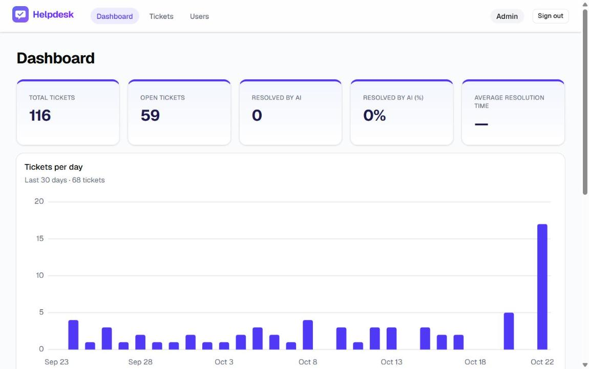
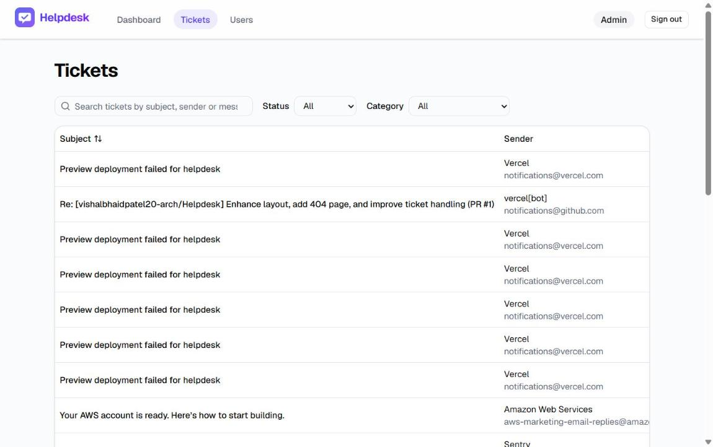
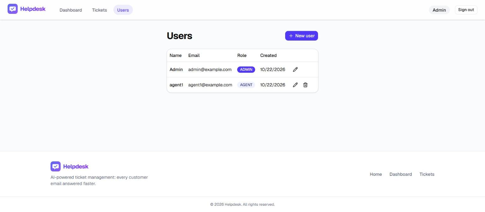
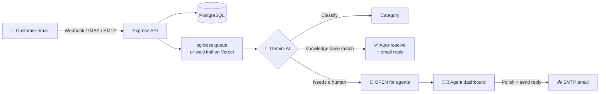
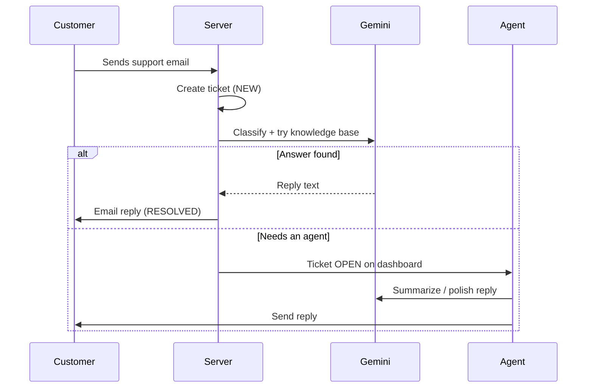

<div align="center">


# 🎫 Helpdesk

### AI-powered ticket management: every support email answered faster

Support emails become tickets. AI classifies them, summarizes them and suggests replies drawn from a knowledge base.
Agents work tickets from a dashboard, and admins manage the team.

[](https://helpdesk-beige-three.vercel.app/)
[](https://bun.sh)
[](https://www.typescriptlang.org/)


[**🚀 Live Demo**](https://helpdesk-beige-three.vercel.app/) ·
[**📸 Screenshots**](#-screenshots) ·
[**⚡ Quick Start**](#-quick-start) ·
[**☁️ Deploy**](DEPLOYMENT.md)

</div>

---

## 📑 Table of Contents

- [The Problem](#-the-problem)
- [Features](#-features)
- [Screenshots](#-screenshots)
- [How It Works](#-how-it-works)
- [Tech Stack](#-tech-stack)
- [Project Structure](#-project-structure)
- [Quick Start](#-quick-start)
- [Environment Variables](#-environment-variables)
- [Scripts](#-scripts)
- [API Reference](#-api-reference)
- [Testing](#-testing)
- [Deployment](#-deployment)

---

## 💡 The Problem

> We receive hundreds of support emails every day. Agents read, classify and answer each one by hand, which is slow and ends in impersonal, canned replies.

**Helpdesk** uses AI to classify, answer and route tickets automatically, so customers get faster, more personal answers and agents have time for the complex issues.

---

## ✨ Features

| | Feature | Description |
|:-:|---|---|
| 📥 | **Email to ticket** | Inbound emails arrive by JSON webhook, IMAP polling or the built-in SMTP server, and become tickets automatically |
| 🏷️ | **AI classification** | Each ticket is sorted into *General Question*, *Technical Question* or *Refund Request* |
| 🤖 | **AI auto-resolve** | Easy questions are answered from the knowledge base and resolved without an agent |
| 📝 | **AI summaries** | One click turns a long thread into a short summary |
| ✍️ | **AI reply polishing** | Agents draft a reply and the AI makes it clear and friendly before it is emailed |
| 🔎 | **Search, filter, sort** | Find tickets by subject, sender or message, and filter by status and category |
| 👤 | **Assignment** | Assign tickets to agents and track who owns what |
| 📊 | **Dashboard** | Totals, open tickets, AI resolution rate, average resolution time and a tickets-per-day chart |
| 🛡️ | **Roles & auth** | Session-based auth with **Admin** and **Agent** roles; admins manage users |
| 📧 | **Email replies** | Replies are sent to the customer over SMTP (e.g. Gmail) and saved in the thread |
| 🚨 | **Error reporting** | Optional Sentry on both client and server, with personal data scrubbed |

### 🔁 Ticket lifecycle

| Status | Meaning |
|---|---|
| `NEW` | Just received from email |
| `PROCESSING` | AI is classifying / trying to auto-resolve |
| `OPEN` | Waiting for an agent |
| `RESOLVED` | Answered (by an agent or the AI) |
| `CLOSED` | Done |

### 👥 User roles

| Role | Can do |
|---|---|
| 🔑 **Admin** | Everything an agent can, plus create, edit and delete agents |
| 🧑‍💼 **Agent** | View, assign, reply to and update tickets |

---

## 📸 Screenshots

<table>
  <tr>
    <td width="50%">
      <b>🏠 Home</b><br/>
      
    </td>
    <td width="50%">
      <b>📊 Dashboard</b><br/>
      
    </td>
  </tr>
  <tr>
    <td width="50%">
      <b>🎫 Tickets</b><br/>
      
    </td>
    <td width="50%">
      <b>👥 Users (admin only)</b><br/>
      
    </td>
  </tr>
</table>

---

## ⚙️ How It Works





---

## 🧰 Tech Stack

| Layer | Technology |
|---|---|
| **Frontend** | React 19, TypeScript, Vite, Tailwind CSS 4, shadcn/ui (Radix), React Router, TanStack Query & Table, React Hook Form + Zod |
| **Backend** | Bun, Express 5, TypeScript, Helmet |
| **Auth** | Better Auth (database sessions) |
| **Database** | PostgreSQL + Prisma 7 |
| **AI** | Google Gemini via the Vercel AI SDK |
| **Email** | Inbound: webhook, `imapflow` polling, `smtp-server` · Outbound: `nodemailer` |
| **Jobs** | pg-boss (Postgres-backed queue); `waitUntil` on Vercel |
| **Testing** | Bun test, Vitest + Testing Library, Playwright |
| **Monitoring** | Sentry |
| **Deploy** | Vercel (CDN + Bun function) or Docker |

---

## 🗂️ Project Structure

```text
Helpdesk/
├── 📁 api/              # Vercel Function entry (wraps the Express app)
├── 📁 client/           # React + Vite frontend
│   └── src/
│       ├── components/  # UI: tickets table, reply form, dialogs, charts…
│       ├── hooks/       # TanStack Query hooks (useTickets, useUsers…)
│       ├── lib/         # API client, auth client, helpers
│       └── pages/       # Home, Dashboard, Tickets, Ticket detail, Users, Login
├── 📁 core/             # Shared Zod schemas (ticket, user) used by client + server
├── 📁 server/           # Express API
│   ├── prisma/          # Schema, migrations and seed scripts
│   ├── src/lib/         # AI, email, queue and ticket-processing logic
│   ├── src/routes/      # tickets, users, stats, webhooks, cron
│   └── knowledge-base.md
├── 📁 e2e/              # Playwright end-to-end tests
├── 🐳 Dockerfile        # Single-container self-hosting
├── ▲ vercel.json        # Vercel build, rewrites and cron
└── 📄 DEPLOYMENT.md     # Step-by-step deploy guide
```

---

## ⚡ Quick Start

### Prerequisites

- [Bun](https://bun.sh) 1.x
- PostgreSQL 14+
- *(optional)* A Google Gemini API key and a Gmail app password

### 1️⃣ Clone and install

```bash
git clone https://github.com/vishalbhaidpatel20-arch/Helpdesk.git
cd Helpdesk
bun install
```

### 2️⃣ Configure the server

```bash
cp server/.env.example server/.env
# then fill in DATABASE_URL, BETTER_AUTH_SECRET, INBOUND_EMAIL_SECRET …
```

### 3️⃣ Set up the database

```bash
bun run --cwd server db:migrate      # apply migrations
bun run --cwd server db:seed         # create the first admin (SEED_ADMIN_EMAIL / PASSWORD)
bun run --cwd server db:seed:ai      # create the AI assistant user
bun run --cwd server db:seed:tickets # (optional) sample tickets
```

### 4️⃣ Run it

```bash
bun run dev
```

| Service | URL |
|---|---|
| 🖥️ Client | http://localhost:5173 |
| 🔌 API | http://localhost:3000 |
| ❤️ Health check | http://localhost:3000/api/health |

---

## 🔐 Environment Variables

<details>
<summary><b>Click to expand</b></summary>

| Variable | Required | Description |
|---|:-:|---|
| `DATABASE_URL` | ✅ | PostgreSQL connection string |
| `BETTER_AUTH_SECRET` | ✅ | Long random string (`openssl rand -base64 32`) |
| `BETTER_AUTH_URL` | ✅ | Public origin of the API |
| `CLIENT_URL` | ✅ | Public origin of the client |
| `INBOUND_EMAIL_SECRET` | ✅ | Shared secret for the inbound email webhook |
| `SEED_ADMIN_EMAIL` / `SEED_ADMIN_PASSWORD` | ⚙️ | Used once by `db:seed` |
| `GOOGLE_GENERATIVE_AI_API_KEY` | ➖ | Enables AI; without it tickets go straight to agents |
| `IMAP_USER` / `SMTP_PASSWORD` | ➖ | Mailbox to poll and its app password |
| `MAIL_USER` / `MAIL_PASSWORD` / `MAIL_HOST` | ➖ | Outbound SMTP for replies |
| `SMTP_DOMAIN` | ➖ | Enables the built-in SMTP server (not on Vercel) |
| `CRON_SECRET` | ➖ | Protects `/api/cron/poll-inbox` |
| `SENTRY_DSN` / `VITE_SENTRY_DSN` | ➖ | Error reporting |

✅ required · ⚙️ setup only · ➖ optional — see [`server/.env.example`](server/.env.example) for the full list.

</details>

---

## 📜 Scripts

| Command | What it does |
|---|---|
| `bun run dev` | Start client and server in watch mode |
| `bun run dev:client` | Start only the client |
| `bun run dev:server` | Start only the server |
| `bun run --cwd server test` | Server unit tests |
| `bun run --cwd client test` | Client component tests |
| `bun run test:e2e` | Playwright end-to-end tests |
| `bun run test:e2e:ui` | Playwright in UI mode |
| `bun run --cwd server db:migrate` | Create / apply migrations |
| `bun run --cwd server db:classify:tickets` | Re-run AI classification on existing tickets |

---

## 🔌 API Reference

<details>
<summary><b>Click to expand</b></summary>

| Method | Endpoint | Description |
|:-:|---|---|
| `GET` | `/api/health` | Health check |
| `GET` | `/api/tickets` | List tickets (search, filter, sort, paginate) |
| `GET` | `/api/tickets/agents` | Agents a ticket can be assigned to |
| `GET` | `/api/tickets/:id` | Ticket details |
| `PATCH` | `/api/tickets/:id` | Update status, category or assignee |
| `GET` | `/api/tickets/:id/replies` | Reply thread |
| `POST` | `/api/tickets/:id/replies` | Send a reply (emails the customer) |
| `POST` | `/api/tickets/:id/replies/polish` | AI-polish a draft reply |
| `POST` | `/api/tickets/:id/summary` | AI summary of the ticket |
| `GET` | `/api/stats` | Dashboard statistics |
| `GET` | `/api/users` | List users *(admin)* |
| `POST` | `/api/users` | Create user *(admin)* |
| `PATCH` | `/api/users/:id` | Edit user *(admin)* |
| `DELETE` | `/api/users/:id` | Delete user *(admin)* |
| `POST` | `/api/webhooks/inbound-email` | Receive an email (`x-webhook-secret` header) |
| `GET` | `/api/cron/poll-inbox` | Poll the IMAP inbox (`Bearer CRON_SECRET`) |

</details>

---

## 🧪 Testing

| Level | Tool | Location |
|---|---|---|
| 🧩 Unit (server) | Bun test | `server/src/**/*.test.ts` |
| 🧱 Component (client) | Vitest + Testing Library | `client/src/**/*.test.tsx` |
| 🌐 End-to-end | Playwright | `e2e/*.spec.ts` |

E2E specs cover login, sessions, authorization, user CRUD, the tickets list, ticket detail and inbound email.

---

## ☁️ Deployment

| Option | How |
|---|---|
| ▲ **Vercel** | One project serves the client from the CDN and the API as a Bun function. Full guide in [`DEPLOYMENT.md`](DEPLOYMENT.md) |
| 🐳 **Docker** | `docker build -t helpdesk . && docker run -p 3000:3000 --env-file server/.env helpdesk` runs API, client, IMAP poller and worker in one container |

---

<div align="center">

### ⭐ If you find this project useful, give it a star!

Made with ❤️ by [**Vishal Patel**](https://github.com/vishalbhaidpatel20-arch)

</div>
