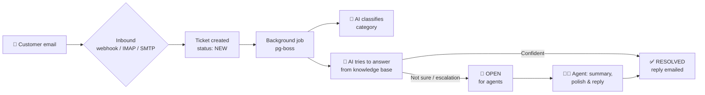

<div align="center">

# 🎫 Helpdesk — AI-Powered Ticket Management System

Support emails become tickets. AI classifies them, summarizes them, and suggests replies from a knowledge base.
Agents work tickets from a dashboard, and admins manage agents.

[](https://helpdesk-flame.vercel.app)


[Live Demo](https://helpdesk-flame.vercel.app) · [Deployment Guide](DEPLOYMENT.md) · [Report a Bug](https://github.com/vishalbhaidpatel20-arch/Helpdesk/issues)

</div>

---

## 📑 Table of Contents

- [About the Project](#-about-the-project)
- [Features](#-features)
- [Screenshots](#-screenshots)
- [Tech Stack](#-tech-stack)
- [How It Works](#-how-it-works)
- [Project Structure](#-project-structure)
- [Getting Started](#-getting-started)
- [Environment Variables](#-environment-variables)
- [Available Scripts](#-available-scripts)
- [API Overview](#-api-overview)
- [Testing](#-testing)
- [Deployment](#-deployment)
- [Roadmap](#-roadmap)
- [Contributing](#-contributing)
- [License](#-license)
- [Contact](#-contact)

---

## 📖 About the Project

**The problem:** Support teams receive hundreds of emails a day. Agents read, classify and answer each one by hand, which is slow and leads to impersonal, canned responses.

**The solution:** Helpdesk turns every incoming email into a ticket and runs it through AI:

- it **classifies** the ticket (General Question, Technical Question, Refund Request),
- it tries to **auto-resolve** it from a knowledge base and emails the answer to the customer,
- if it can't, the ticket opens for a human agent, who gets **AI summaries** and **AI-polished replies**.

Agents spend their time on the complex issues, and customers get faster, more personal answers.

---

## ✨ Features

| Feature | Description |
| --- | --- |
| 📥 **Email → Ticket** | Receive email via JSON webhook, IMAP polling (e.g. Gmail) or a built-in SMTP server |
| 🤖 **AI Classification** | Each new ticket is categorized automatically |
| ⚡ **AI Auto-Resolve** | Answers from `knowledge-base.md` with a confidence check and escalation rules |
| 📝 **AI Summaries** | One-click summary of the email and the full reply thread |
| ✨ **AI Reply Polish** | Turns an agent's rough draft into a friendly, professional reply |
| 📋 **Ticket List** | Search, filter by status/category, server-side sorting and pagination |
| 🔍 **Ticket Detail** | Change status, category and assignee; reply by email (threaded) |
| 📊 **Dashboard** | Total / open tickets, AI-resolved count and %, avg. resolution time, tickets-per-day chart |
| 👥 **User Management** | Admins create, edit and remove agents |
| 🔐 **Authentication** | Session-based auth with Better Auth; public sign-up disabled |
| 🛡️ **Error Monitoring** | Optional Sentry for server and browser |

**Ticket statuses:** `Open` · `Resolved` · `Closed`
**User roles:** `Admin` (manages agents) · `Agent` (works tickets)

---

## 📸 Screenshots

> Add your images to `docs/screenshots/` with the file names below and they will show up here.

| Login | Dashboard |
| :---: | :---: |
|  |  |

| Ticket List | Ticket Detail |
| :---: | :---: |
|  |  |

| AI Summary & Reply Polish | User Management |
| :---: | :---: |
|  |  |

<!-- Optional demo GIF -->
<!--  -->

---

## 🛠️ Tech Stack

| Layer | Technology |
| --- | --- |
| **Frontend** | React 19, TypeScript, Vite, Tailwind CSS v4, shadcn/ui, React Router, TanStack Query & Table, React Hook Form + Zod |
| **Backend** | Bun, Express, TypeScript |
| **Database** | PostgreSQL + Prisma ORM |
| **Auth** | Better Auth (database sessions) |
| **AI** | Google Gemini via the Vercel AI SDK |
| **Email** | Inbound: webhook / IMAP / SMTP server · Outbound: Nodemailer (SMTP) |
| **Jobs** | pg-boss (Postgres queue); `waitUntil` on Vercel |
| **Testing** | Vitest + Testing Library, Bun test, Playwright (E2E) |
| **Deployment** | Vercel (CDN + Bun Function) + hosted PostgreSQL |
| **Monitoring** | Sentry |

---

## ⚙️ How It Works



---

## 📁 Project Structure

```
Helpdesk/
├── api/            # Vercel Function entry (wraps the Express app)
├── client/         # React + Vite frontend
│   └── src/pages/  # Login, Dashboard, Tickets, TicketDetail, Users
├── core/           # Shared types & Zod schemas (client + server)
├── server/         # Express API (Bun)
│   ├── prisma/     # Schema, migrations, seed scripts
│   ├── src/routes/ # API routes
│   ├── src/lib/    # AI, email, queue, IMAP/SMTP logic
│   └── knowledge-base.md
├── e2e/            # Playwright end-to-end tests
├── DEPLOYMENT.md   # Vercel deployment guide
└── vercel.json
```

---

## 🚀 Getting Started

### Prerequisites

- [Bun](https://bun.sh) 1.x
- PostgreSQL 14+ (local or hosted, e.g. Neon / Supabase)
- *(Optional)* Google Gemini API key
- *(Optional)* Gmail account with an app password for sending/receiving email

### Installation

```bash
# 1. Clone the repository
git clone https://github.com/vishalbhaidpatel20-arch/Helpdesk.git
cd Helpdesk

# 2. Install dependencies (all workspaces)
bun install

# 3. Create the server environment file
cp server/.env.example server/.env
# then edit server/.env (see Environment Variables below)

# 4. Run database migrations
bun run --cwd server db:migrate

# 5. Create the first admin and the AI agent
bun run --cwd server db:seed
bun run --cwd server db:seed:ai

# 6. (Optional) Add 100 sample tickets
bun run --cwd server db:seed:tickets

# 7. Start client + server
bun run dev
```

Open **http://localhost:5173** and sign in with the admin email and password from your `.env`.

---

## 🔑 Environment Variables

Create `server/.env` from `server/.env.example`:

| Variable | Required | Description |
| --- | :---: | --- |
| `DATABASE_URL` | ✅ | PostgreSQL connection string |
| `BETTER_AUTH_SECRET` | ✅ | Long random string (`openssl rand -base64 32`) |
| `BETTER_AUTH_URL` | ✅ | Public URL of the API (e.g. `http://localhost:3000`) |
| `CLIENT_URL` | ✅ | Frontend URL (e.g. `http://localhost:5173`) |
| `INBOUND_EMAIL_SECRET` | ✅ | Secret for the inbound-email webhook |
| `SEED_ADMIN_EMAIL` / `SEED_ADMIN_PASSWORD` | ⚙️ | First admin, used once by `db:seed` |
| `GOOGLE_GENERATIVE_AI_API_KEY` | ➖ | Enables all AI features |
| `IMAP_USER` / `SMTP_PASSWORD` | ➖ | Mailbox + Gmail app password (receive & send email) |
| `CRON_SECRET` | ➖ | Secret for the Vercel cron inbox poll |
| `SENTRY_DSN` | ➖ | Error reporting |

> ⚠️ Never commit real secrets. `.env` is git-ignored.

---

## 📜 Available Scripts

| Command | Description |
| --- | --- |
| `bun run dev` | Run client and server together |
| `bun run dev:client` | Run only the frontend |
| `bun run dev:server` | Run only the API (watch mode) |
| `bun run test:e2e` | Run Playwright E2E tests |
| `bun run test:e2e:ui` | Playwright in UI mode |
| `bun run --cwd client test` | Frontend unit tests (Vitest) |
| `bun run --cwd server test` | Backend unit tests (Bun) |
| `bun run --cwd server db:migrate` | Create/apply migrations |
| `bun run --cwd server db:seed:tickets` | Insert sample tickets |
| `bun run --cwd server db:classify:tickets` | AI-classify uncategorized tickets |

---

## 🔌 API Overview

| Method | Endpoint | Description |
| --- | --- | --- |
| `GET` | `/api/health` | Health check |
| `POST` | `/api/webhooks/inbound-email` | Create a ticket from an email (header `x-webhook-secret`) |
| `GET` | `/api/tickets` | List tickets (`status`, `category`, `search`, `sort`, `order`, `page`, `pageSize`) |
| `GET` | `/api/tickets/:id` | Ticket detail |
| `PATCH` | `/api/tickets/:id` | Update status, category or assignee |
| `POST` | `/api/tickets/:id/replies` | Send a reply by email |
| `POST` | `/api/tickets/:id/replies/polish` | AI-polish a reply draft |
| `POST` | `/api/tickets/:id/summary` | AI summary of the ticket |
| `GET` | `/api/tickets/agents` | List assignable agents |
| `GET` | `/api/stats` | Dashboard statistics |

**Example – send a test email to the webhook:**

```bash
curl -X POST http://localhost:3000/api/webhooks/inbound-email \
  -H "Content-Type: application/json" \
  -H "x-webhook-secret: $INBOUND_EMAIL_SECRET" \
  -d '{
    "senderName": "Jane Doe",
    "senderEmail": "jane@example.com",
    "subject": "Cannot reset my password",
    "text": "Hi, the reset link is not working. Please help."
  }'
```

---

## 🧪 Testing

```bash
bun run --cwd client test   # React components (Vitest + Testing Library)
bun run --cwd server test   # Server logic (Bun test)
bun run test:e2e            # Full end-to-end flows (Playwright)
```

E2E tests cover login, sessions, authorization, user CRUD, the ticket list, ticket detail and inbound email.

---

## ☁️ Deployment

The app deploys to **Vercel** as a single project: the client is served from the CDN and the API runs as a Vercel Function on the Bun runtime, with any hosted PostgreSQL.

👉 Full step-by-step guide: **[DEPLOYMENT.md](DEPLOYMENT.md)**

---

## 🗺️ Roadmap

- [x] Email to ticket (webhook, IMAP, SMTP)
- [x] AI classification, auto-resolve, summaries and reply polish
- [x] Dashboard with statistics
- [x] Admin user management
- [ ] SendGrid / Mailgun inbound adapters
- [ ] Attachments on tickets
- [ ] Knowledge base editor in the UI

---

## 🤝 Contributing

Contributions are welcome!

1. Fork the project
2. Create a branch: `git checkout -b feature/amazing-feature`
3. Commit: `git commit -m "Add amazing feature"`
4. Push: `git push origin feature/amazing-feature`
5. Open a Pull Request

---

## 📄 License

Distributed under the MIT License. See `LICENSE` for more information.

---

## 📬 Contact

**Vishal Patel** — [@vishalbhaidpatel20-arch](https://github.com/vishalbhaidpatel20-arch)

Project link: [github.com/vishalbhaidpatel20-arch/Helpdesk](https://github.com/vishalbhaidpatel20-arch/Helpdesk)

<div align="center">

⭐ If you found this project useful, please give it a star!

</div>
